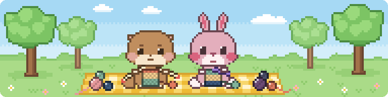
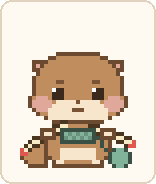
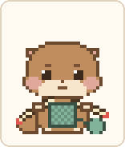
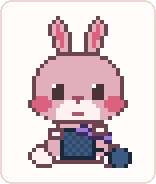
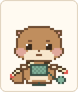
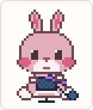
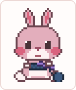
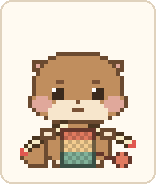
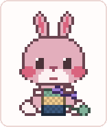

# 함뜨마을 동물 친구들

**한 단 한 단 같이 세어주는 픽셀 뜨개 친구들**

뜨개인 여러분, 한 단 한 단 종이에 체크하려니 번거롭지 않으셨나요? 
함뜨마을에서는 대바늘로 뜰 땐 단수달 🦦이, 코바늘로 뜰 땐 코토키 🐰가 옆에서 같이 떠요. 
배색뜨기·방안뜨기 도안은 카냥이 🐱가 발바닥으로 칠하고, 어디까지 떴는지 짚어줘요. 
같이 뜨면 절대 헷갈리지 않아요.

### 🧶 [지금 써보기 → ssurxiv.github.io/dansudal](https://ssurxiv.github.io/dansudal/)

## 🏡 함뜨마을 친구들을 소개해요

화면 맨 위 탭을 눌러 친구를 고르면 돼요. 진행 상황은 친구마다 따로
저장되니, 대바늘 작품과 코바늘 작품을 동시에 떠도 섞이지 않아요.

| | 단수달 🦦 | 코토키 🐰 | 카냥이 🐱 |
| --- | --- | --- | --- |
| **이름** | **단수** 세는 **수달** | **코**바늘 뜨는 **토끼** | 도안 칠하는 **냥이** (이름은 가제) |
| **도구** | 대바늘 두 짝 | 코바늘 하나 | 발바닥 젤리 |
| **성격** | 약간 과묵한 감자 같은 수달. 말수 적고 표정은 눈과 귀로 | 깨발랄 햇살 토끼. 발그레한 볼과 쫑긋한 귀 | 약간 새초롬한 고양이. 시큰둥한 눈, 틀리면 "흥" |
| **하는 일** | 단수 세기 | 단수 세기 | 배색·방안 도안 그리기와 진행 체크 |
| **완성품** | 🧣 목도리 | 🧢 비니 | 🧶 도안 무늬 그대로의 양탄자 |

## ✨ 뭘 할 수 있나요?

| | 단수달 | 코토키 |
| --- | :---: | :---: |
| **🧶 한 단 떴어요** `Space` 단수가 하나 오르고, 들고 있는 편물이 조금씩 자라요. |  |  |
| **✂️ 한 단 풀기** `Backspace` 틀렸으면 방금 뜬 단을 되돌려요. 흠칫(!) 하고 바늘을 빼서 실을 당기면 풀린 실은 바닥에 쌓여요. |  |  |
| **🧵 실 감기** `W` 바닥에 쌓인 실은 다시 감아야 다음 단에 쓸 수 있어요. |  |  |
| **🎨 실 색 바꾸기** 실 창고에서 새 색을 고르면 그때부터 그 색으로 떠져요. 완성품에도 줄무늬로 남아요. |  |  |
| **✨ 완성 & 입어보기** 목표 단수를 채우면 반짝! 완성품을 자랑하고, 입어보기로 직접 둘러볼 수 있어요. |  |  |

## 🐱 카냥이와 배색 도안 뜨기

카냥이 탭은 단수를 세는 대신 **도안**을 다뤄요. 위의 **✏️ 도안 그리기 /
🧶 뜨기**로 화면을 바꿔요.

**✏️ 도안 그리기**

- **🐾 칠하기** `B`: 칸을 누르거나 끌어서 칠해요. 커서는 맨 앞 발가락을 칠할 색
  잉크에 담근 고양이 발이에요. **굵기**(1·2·3칸, `[` `]`)로 한 번에 칠하는 넓이를
  바꿔요(지우개도 같아요).
  카냥이가 물감 묻은 젤리를 들고 있다가 손을 떼면 꾹 찍어요. 칠한 칸
  군데군데 발도장 자국이 남아요.
- **⬜ 사각형** `R`: 끌어서 영역을 잡으면 한 번에 채워요.
- **🧽 지우개** `E`: 칠한 칸을 바탕으로 되돌려요.
- **↶ 되돌리기 / ↷ 다시** `Ctrl+Z` / `Ctrl+Shift+Z`: 붓질 한 번,
  사각형 하나, 크기 바꾸기 하나가 각각 한 번에 되돌아가요.
- **색**: 기본 팔레트(실 창고 색)에서 고르거나, 맨 앞 `+`를 눌러 RGB
  슬라이더나 HEX로 새 색을 만들어요. 팔레트엔 최근 8색까지 담기고, 새 색은
  맨 앞에 들어오며 넘치면 가장 오래된 색이 빠져요(그 색으로 칠한 칸은 그대로). 팔레트 맨 앞 `바탕`을 누르면
  바탕색을 바꿔요(팔레트 색을 눌러도, 슬라이더·HEX로 만들어도 돼요).
- **크기**: 가로 2~60코, 세로 2~100단. 맨 아랫줄(1단)과 왼쪽 끝을
  기준으로 늘거나 줄어요.
- **🗑️ 새 도안**: 칠한 칸과 뜬 기록을 같이 지워요. 되돌리기 한 번이면 둘 다
  돌아와요.

**🧶 뜨기**

- 도안은 아래에서 위로 읽어요. **평면뜨기(왕복)** 는 겉면 단을 오른쪽부터,
  안면 단을 왼쪽부터 읽는 지그재그이고, **원통뜨기** 는 매 단 오른쪽부터예요.
  단 번호도 그 단을 읽기 시작하는 쪽에 붙어요.
- 지금 단을 같은 색끼리 묶은 **구간**으로 보여줘요(예: 🔵 4 · ⚪ 16).
  카냥이가 다음에 뜰 구간을 말해줘요.
- 뜨기 화면에선 카냥이가 작은 베틀 뒤에 앉아요. 구간을 뜨면 북이 그 구간만큼
  지나가며 도안을 짜고, 한 단을 마치면 바디로 탁 다져요. 북은 단마다
  왼쪽·오른쪽을 번갈아 가요.
- **🐾 한 구간 떴어요** `Space`, **🧶 한 단 떴어요** `Enter`로 넘기고,
  **↩️ 한 구간 풀기** `Backspace`, **✂️ 한 단 풀기** `Shift+Backspace`로
  되돌려요(풀면 카냥이가 흥 하며 그만큼 풀어요). 도안 칸을 누르면 거기까지
  뜬 걸로 체크돼요.
- 아직 안 뜬 칸은 흐리게 보이고, 뜬 칸만 원래 색으로 진해져요. 다 뜬 단
  끝에는 발도장이 찍혀요. 마지막 단까지 뜨면 카냥이가 베틀에서 다 짠
  양탄자를 떼어 펼쳐 들고 자랑해요.
  **🧶 깔고 앉기 / ✨ 자랑하기**로 양탄자 위에 앉히거나 다시 들게 할 수 있어요.

그 밖에도 (단수달·코토키),

- **🔔 알림**: "20단에서 코 줄임", "8단마다 꽈배기"처럼 특정 단이나
  N단마다(구간 지정 가능) 말풍선으로 알려줘요. 코 줄임·코 늘림·꽈배기
  알림이 걸린 단은 진행 칸에도 `^` `V` `X` 표시가 생겨요.
- **🔁 새로 뜨기**: 총 단수는 그대로 두고 진행 상황과 알림만 처음으로
  되돌려요.
- **+ / −**: 캐릭터를 크게 또는 작게 볼 수 있어요.

## 📋 화면 구성

| 요소 | 뜻 |
| --- | --- |
| 위쪽 탭 | 단수달 🦦 / 코토키 🐰 / 카냥이 🐱 전환. 진행 상황은 친구마다 따로 저장돼요 |
| 진행 칸 | 한 칸이 한 단. 뜬 단은 그 단을 뜬 실 색으로 채워져요 |
| 뜬 단수/총 단수 | 지금까지 뜬 단수와 목표 단수. 총 단수는 실수로 바뀌지 않게 ✎를 눌러야 고칠 수 있어요 |
| 쓴 볼 수/보유 볼 수 | 다 쓴 실뭉치 수(−/+) / 갖고 있는 실뭉치 수(✎, 선택 입력) |

진행 상황은 이 브라우저에 자동으로 저장돼요. 다른 기기에서는 이어지지
않아요.

## 💡 왜 만들었나요?

뜨개질하다 단수를 놓치는 게 싫어서 만든 개인 프로젝트입니다. 그냥
숫자만 세는 카운터 앱이 아니라, 실이 늘고 줄고 다시 감기는 과정
전체가 하나의 캐릭터 애니메이션으로 이어지도록 만들었어요.

처음엔 대바늘을 뜨는 단수달 하나였는데, 코바늘 뜨는 분들도 같이 쓸 수
있게 두 번째 친구 코토키가 생겼고, 배색·방안 도안을 칸칸이 짚어줄 세 번째
친구 카냥이가 생겼어요. 그렇게 하나둘 모인 동물 친구들이 사는 곳이
함뜨마을이에요.

## 💬 피드백

써보시고 의견이나 추가됐으면 하는 기능이 있다면 인스타그램
[@tteoboja_0](https://instagram.com/tteoboja_0)로 편하게 DM 주세요!

## 🔖 저작권

© 2026 [@tteoboja_0](https://instagram.com/tteoboja_0). 무단 재배포
금지. 자세한 조건은 `LICENSE.txt` 참조.
